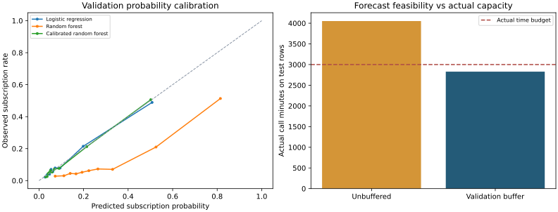
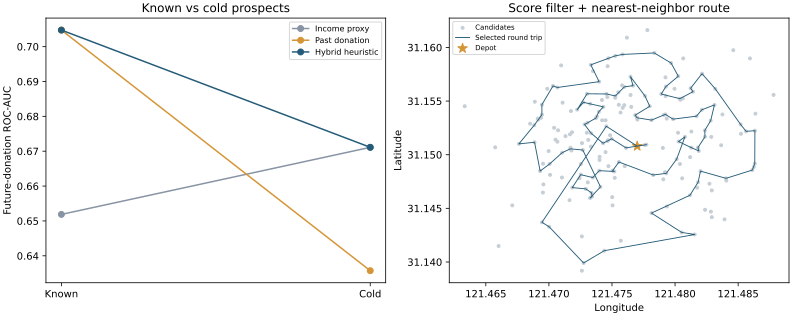

# Business ML & Decision Analytics

Machine learning case studies connecting predictions to business decisions in marketing, inventory optimization, and operations.

The central question is **how a prediction changes an operational decision**. These cases combine model evaluation with explicit costs, resource constraints, simple policy baselines, and analysis of where the resulting decisions fail.

## Featured case studies

| Case | Business decision | Methods | Reproduced result |
| --- | --- | --- | --- |
| [Bank marketing](projects/bank-marketing/README.md) | Whom should a bank contact under a call-time budget? | Classification, probability calibration, duration regression, validation-selected safety buffers | Calibrated forest test ROC-AUC **0.8092**; forecast-feasible policies can still exceed actual capacity |
| [Donor targeting & routing](projects/donor-routing/README.md) | Whom should a field team visit within a travel budget? | Proxy-label comparison, subgroup evaluation, hybrid scoring, constrained routing heuristics | **97 visits in 14.946 km**; comparisons against score-first and nearest-first baselines |





## What the projects demonstrate

- **Decision-aware evaluation:** ranking and calibration metrics are linked to contact costs, time, travel, and simulated net proceeds.
- **Explicit baselines:** a more complicated duration model is compared with the training mean; route selection is compared with value-only and distance-only heuristics.
- **Training-only preprocessing:** each model owns its fitted preprocessing, including inside calibration folds. Model selection and safety buffers use validation rows.
- **Reproducibility:** bundled data with SHA-256 checks, fixed splits and seeds, exported result tables, environment records, and tests for decision boundaries.

## Run the two cases

Use Python 3.12 for the recorded environment. Run these commands from the repository root:

```bash
python -m venv .venv
source .venv/bin/activate
python -m pip install -e .
python -m decision_analytics.bank
python -m decision_analytics.donor
python -m unittest discover -s tests -v
python scripts/verify_repository.py
```

On Windows, activate with `.venv\Scripts\activate`. The case scripts read the compressed data directly and overwrite their own result tables and figures. They do not require Kaggle credentials or a notebook server. Notebook walkthroughs are available inside each featured case; install Jupyter separately to open them.

## Reading the results

The featured cases were rerun during portfolio curation. These are **retrospective course-data evaluations**, and the original test sets had already been examined in the coursework. They are not untouched future-campaign benchmarks. Financial results use stated assumptions and historical or scenario labels; they do not establish causal impact or actual business revenue. Donor income scores are proxy scores, not calibrated future-donation probabilities.

[Evaluation notes](docs/EVALUATION.md) explain the protocol and remaining limits. [Additional case reviews](docs/CASE_REVIEW.md) cover inventory optimization, hotel overbooking, and causal targeting; those source notebooks are retained as reviewed coursework rather than featured as reproduced results.

## Repository guide

| Location | Contents |
| --- | --- |
| [`src/decision_analytics/`](src/decision_analytics) | Reusable preprocessing, targeting policies, routing, and runnable experiments |
| [`projects/`](projects) | Case explanations, walkthrough notebooks, data manifests, result tables, and figures |
| [`tests/`](tests) | Budget, outcome separation, return-to-depot, and preprocessing checks |
| [`archive/`](archive/README.md) | Source-preserving course notebook snapshots and the original bank report |
| [`docs/provenance.json`](docs/provenance.json) | Supplied filenames, original checksums, and documented transformations |

These projects originated in Business Machine Learning coursework. Supplied notebooks include course-provided scaffolding and student implementations. Portfolio curation adds AI-assisted refactoring, evaluation checks, documentation, and the reproducible case scripts. Original cell source text is preserved in the archive; generated runtime metadata and saved outputs are removed from those snapshots. Dataset attribution is documented with each case.
