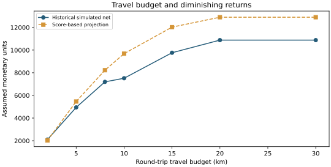

# Donor Targeting & Distance-Constrained Routing

A fictional nonprofit must decide whom to visit when its field team has a limited travel budget. This case examines proxy labels, transfer to new prospects, and the tradeoff between donor score and geographic coverage.

## From labels to a route

The course supplies 27,132 training rows and 18,090 test rows. Past-donation labels are available for **13,566 previously contacted training individuals**. Future donation labels and scenario coordinates are available in the supplied test file.

- **Income proxy:** compare logistic regression, random forest, and gradient boosting for `income_gt50k`.
- **Past donation:** compare the same model families for `if_donated_last_year`, using observed labels from previously contacted training rows.
- **Model selection:** select each stage by AUC on its own stratified 20% internal training holdout, then refit on the applicable source training rows. Feature preprocessing uses fitted training pipelines with unknown-category handling.
- **Hybrid heuristic:** use past-donation scores for known prospects and income scores for cold prospects. This rule is inherited from the course analysis and is evaluated retrospectively.
- **Routing:** take a fixed sample of 200 test prospects; compare score-first, nearest-first, and score-threshold-plus-nearest strategies. Reserve enough distance to return to the depot at every step.

## Subgroup evaluation

The internally selected estimators are gradient boosting for the income proxy and logistic regression for past donation.

| Score | All test ROC-AUC | Known prospects | Cold prospects |
| --- | ---: | ---: | ---: |
| Income proxy | 0.7298 | 0.6519 | **0.6711** |
| Past donation | 0.7526 | **0.7047** | 0.6357 |
| Hybrid heuristic | **0.8040** | **0.7047** | **0.6711** |

Past donation wins overall but transfers less well to cold prospects. The hybrid illustrates a response to this selection-bias problem; it does not establish that the rule will generalize to an untouched population.

## Route comparison

At a 15 km round-trip budget, the combined strategy chooses a score threshold of **0.30** using score-based projected net proceeds, without candidate outcomes. Assumptions: 200 monetary units per donation, 5 per visit, and 10 per kilometer.

| Strategy | Visits | Round-trip km | Observed scenario donations | Historical simulated net |
| --- | ---: | ---: | ---: | ---: |
| Top scores first | 23 | 14.812 | 19 | 3,536.88 |
| Nearest first | 134 | 14.992 | 47 | 8,580.08 |
| Threshold + nearest | 97 | 14.946 | 52 | **9,765.54** |

Scores alone concentrate visits but consume distance. Nearest-first increases coverage. Combining the two gives a stronger net result on this fixed sample. This is a heuristic comparison, not a proof of route optimality or a causal fundraising effect.

Increasing the travel allowance to 20 km expands this selected subset to 105 visits. Increasing it further to 30 km adds no visits under the fixed threshold. The result reflects the chosen candidate set and score rule, rather than a general claim that additional travel never helps.

## Explore and reproduce

- [Notebook walkthrough](analysis.ipynb)
- [Internal model selection](results/model_selection_validation.csv) and [future-donation subgroup results](results/future_donation_test.csv)
- [Route comparisons](results/routes_test.csv), [threshold search](results/threshold_search.csv), and [travel-budget sensitivity](results/budget_sensitivity.csv)
- [Recorded environment and parameters](results/run.json)
- [Runnable experiment](../../src/decision_analytics/donor.py) and [routing functions](../../src/decision_analytics/routing.py)
- [Original source notebook](../../archive/donor-routing/original_source.ipynb)

From the repository root, install with `python -m pip install -e .`, then run `python -m decision_analytics.donor`.

## Interpretation limits

**An income classification score is not a calibrated probability of future donation.** Therefore the optimization quantity is named `score_based_projected_net`, and the realized-label calculation is separately named `historical_simulated_net`. Neither is actual nonprofit revenue. A future implementation should obtain representative donation labels and calibrate response probabilities before relying on expected monetary returns.

The original notebook's hybrid rule was motivated by results on this same course test file; the current model-selection split does not make that file untouched again. The 200-person route comparison has no confidence interval or population-level guarantee. Distances use a Haversine great-circle approximation, not road distances, traffic, or visit-time constraints. Demographic inputs are retained from the supplied exercise; practical outreach would require an appropriate feature and policy review.

The curated pipeline differs from the original notebook: training-only encoding and scaling, internal model selection, deterministic tie handling, and Haversine distances replace the original combined train/test dummy schema and geodesic distance calculation. Current CSVs are fresh reruns, not relabeled original outputs.
